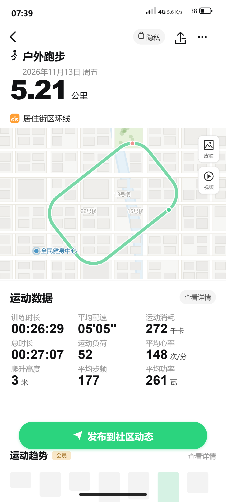
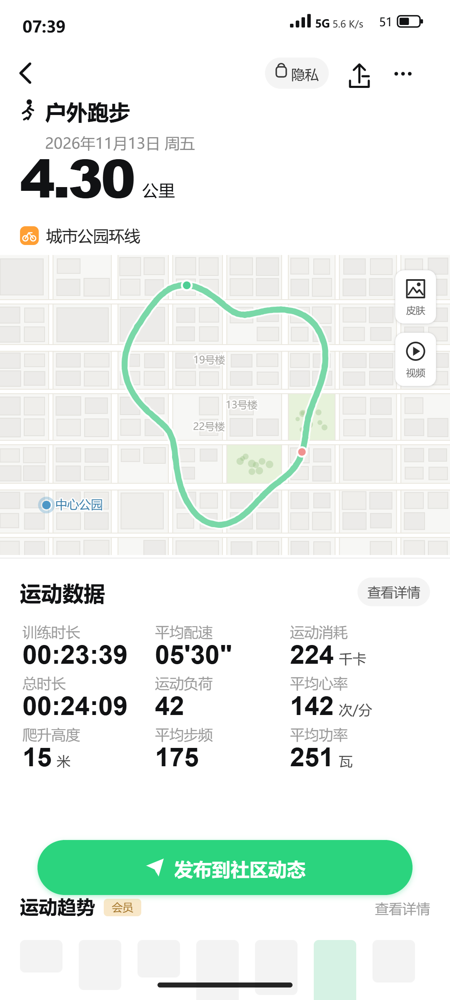
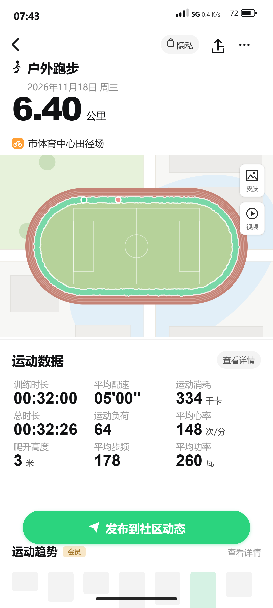
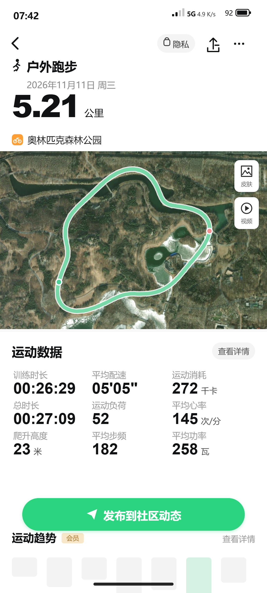
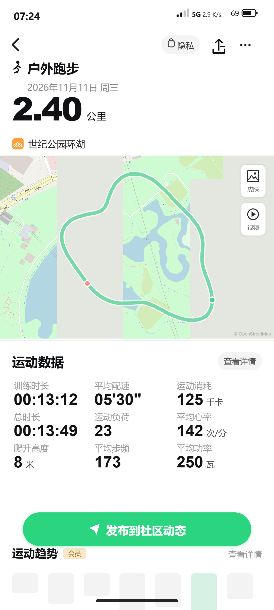
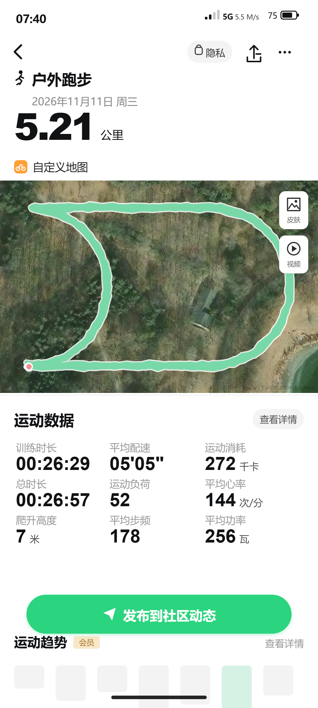

# RUNSHOT · 跑步记录截图批量生成器

按 Keep「户外跑步」数据详情页的版面，批量生成手机全屏截图风格的跑步记录图：左侧填参数，右侧一屏出多张，支持单张下载 PNG 与一键打包 ZIP。

- 纯前端、零依赖、离线可用（程序化底图模式）
- 输出尺寸 1080 × 2400（逻辑 360 × 800，3 倍导出）
- 所有数字由「距离 + 配速」推导，互相咬合，不是各自随机
- 标题下方自动带一行日期（`2026年11月9日 周一`，随每条记录的日期变化）

> **用途限定**：界面设计稿演示、文章配图、原型占位、前端 Canvas 绘图练习。界面里的品牌与标签文字都可改。
>
> **请勿用于**：把它生成的图当作真实运动记录去提交任何**考核、打卡、评奖、索赔或社交背书**。
> 本项目不提供、也不主张这类用途的正当性；作者不对使用它造成的任何后果负责。
> 技术上它能出图，不代表你应该拿它去骗人。

---

## 示例效果

| 街区环线 5.21 km | 公园环湖 4.30 km | 操场跑道 6.40 km |
|---|---|---|
|  |  |  |

| 奥森公园 · 卫星影像底图 | 世纪公园 · 真实街道瓦片 | 自定义地图 · 手绘轨迹 |
|---|---|---|
|  |  |  |

---

## 快速开始

方式一（最简单）：双击 `index.html`。

方式二（真实瓦片模式推荐）：双击 `start.bat`，浏览器打开 `http://localhost:8777/index.html`。

> 更新代码后如果看不到新效果，按 **Ctrl + F5** 强制刷新（浏览器会缓存 JS）；`index.html` 里的资源已带版本号，正常刷新即可拿到最新代码。

## 五步出一批图

1. **里程与配速**：填距离区间（如 3.0–6.5 km）与配速区间（`5'20"` 或 `5.33` 两种写法都行）
2. **时间安排**：起始日期 + 周数 + 每周张数 + 开跑时段 + 星期偏好（默认周一/三/五）
3. **轨迹与地图**：勾选想要的轨迹类型（可多选，会轮转分配保证每种都出现），选择底图模式与地点；地点选「自定义地图（选点画轨迹）」可在电子地图上自己找地方、自己画轨迹

### 自定义地图（选点画轨迹）

地点选「自定义地图（选点画轨迹）」后，面板里出现一块可交互地图（初始为全中国视野）：

1. **找地方**：滚轮缩放 / 拖动平移；快选下拉含 36 个城市 + **18 个热门跑步地点**（奥森、世纪公园、西湖、东湖绿道等，直接跳到能看清跑道的缩放级别）；「找地点」框可**粘贴经纬度**一步跳转（z17），联网时也支持地名搜索（先试 Photon，再试 Esri 地理编码，两个都连不上会明确提示改用坐标/快选）；底图四选一——**卫星（Esri World Imagery）**、**卫星（高德）**、**电子地图**（高德路网，中文标注，Esri 街道图 / OSM 兜底）、**Google 卫星**（国内不可达时自动回退 Esri）；工具栏「⛶ 大图」可切换全屏大图选点（Esc 退出）
2. **画轨迹**（两种方式任选）：
   - **画线**：沿跑步路线按住鼠标描一圈（支持撤销 / 清空，可分多段连画）
   - **校准**：在跑道上**点 3~6 个点**（弯道前后、直道中部各点几个），自动用平滑闭环样条拟合成贴合跑道的环形轨迹——**跑道朝向、歪斜、偏移全部跟随你点的点**，不用管跑道是东西向还是南北向；锚点间实时显示虚线预览与橙色编号
3. **生成**：截图底图就是该地点的真实瓦片影像（带版权标注）；画的**闭环**会按设定的距离自动换算圈数——描一圈操场、设 5 km，就自动跑 12 圈叠在同一条线上（带 ±0.5 m 换道漂移），和真人跑圈完全一致；**开放路径**则单程缩放到目标距离
4. 轨迹长度、地理位置、底图三者严格对齐，路径只存在于当前页面内存中，刷新后需重画

4. **真实感参数**：体重（联动消耗/功率）、心率区间、路线标签文字、随机种子
5. 点 **生成截图** → 点缩略图看大图 → 单张下载 或 **打包下载 ZIP**

同一个种子 + 同一组参数，生成结果完全一致，方便复现。

## 参数说明

| 参数 | 说明 |
|---|---|
| 距离范围 | 3.0–6.5 表示每张在 3.00~6.50 km 之间取值，保留两位小数 |
| 配速范围 | 每公里用时；上限必须 ≥ 下限，建议 2'30"~15'00" |
| 每周张数 / 周数 | 单次最多 60 张；张数超过所选星期数时会顺延到其他日子 |
| 开跑时段 | 该区间内随机到「分钟」（不取整刻度）；同日同刻自动去重 |
| 体重 | 影响「运动消耗」「平均功率」 |
| 爬升高度 | 留空自动估算（田径场 0–3 m GPS 抖动，其余按路线类型）；填 `12` 固定 12 米；填 `4-18` 每条在区间内随机整数 |
| 随机种子 | 留空自动生成；点 ⟳ 换一个并重新生成 |

## 数字口径（关键：保证截图内部自洽）

以距离 `D`(km)、配速 `P`(min/km) 为基准：

| 指标 | 公式 |
|---|---|
| 训练时长 | `T = D × P`（向下取整到秒，再由 T/D 反算显示配速） |
| 总时长 | `T + 8~40 秒` |
| 平均步频 | `170 + (6.3 − P) × 6 + N(0, 2.2)`，夹在 164–188 |
| 平均步幅 | `1000 / (步频 × P)`，再由步数反算保留两位 |
| 步数 | `D × 1000 / 步幅`，四舍五入 |
| 运动消耗 | `体重 × D × 0.87` |
| 平均心率 | `132 + (6.5 − P) × 10 + N(0, 2.8)`，夹在 124–172 |
| 运动负荷 | `D × (9.5 + (6 − P) × 0.5)` |
| 平均功率 | `体重 × (4.05 + (6 − P) × 0.25)` |
| 爬升高度 | 留空时按路线类型给一个低起伏系数（街区/跑道最平，田径场仅 0–3 m 的 GPS 抖动）；也可在界面上固定或指定区间 |

示例：3.01 km @ 04'28" → 13:26、步频 182、步幅 1.23 m、步数 2447、157 千卡、负荷 31、功率 265 瓦。

## 轨迹模板

| 模板 | 说明 |
|---|---|
| 街区环线 | 圆角矩形绕街区，最接近居住区绕圈跑 |
| 公园环湖 | 带噪声的闭合环，跑几圈会自然叠成一圈半透明轨迹 |
| 操场跑道 | 标准 400 m 跑道（直道 84.39 m + 半径 36.5 m），底图带红色跑道、分道线与内场，逐圈内切漂移 |
| 折返步道 | 去程一条线、回程一条并行的线，远端自动连成一个窄环 |
| 沿河绿道 | 长弧线去回，弯曲幅度更大 |
| 8 字路线 | 双纽线，跨两次路口 |
| 手绘轨迹 | 在选点器上自己画/自己校准，见上文「自定义地图」 |

所有轨迹都叠加了米级 GPS 抖动与白色描边，起终点分别是绿色 / 粉色圆点。

## 状态栏随机化

每张截图的顶部状态栏都由种子随机：信号格数（2–4 格实心）、4G/5G 制式、实时网速（`0.3–9.7 K/s` 或 `1.1–6.4 M/s`）、电量（19–98，低于 20 变红色且填充按百分比伸缩），与开跑时间、配速一样可复现。

## 底图六种模式

| 模式 | 数据来源 | 离线 | 可导出 |
|---|---|---|---|
| **离线规划图**（默认） | Canvas 程序化绘制街区、道路、公园、水系、楼栋标注（`xx号楼`）与 POI | ✅ 完全离线，同种子结果稳定 | ✅ |
| **自动（在线优先）** | 先试真实瓦片，失败静默降级到离线底图 | 降级后可 | ✅ |
| **真实瓦片** | OpenStreetMap，失败降级 Esri World Street Map | ❌ 需联网 | ✅ |
| **卫星影像（Esri）** | Esri World Imagery | ❌ 需联网 | ✅ |
| **卫星影像（高德）** | 高德卫星瓦片（`webst01.is.autonavi.com`，`style=6`），境外无覆盖时回退 Esri | ❌ 需联网 | ✅ |
| **Google 卫星影像** | `mt{0-3}.google.com`，不可达时回退 Esri | ❌ 需联网，国内一般需代理 | ⚠️ 仅 Esri 回退时可 |

### 瓦片版权与 CORS

各源返回的 `Access-Control-Allow-Origin` 头实测如下（这直接决定能否导出）：

| 源 | ACAO | `crossOrigin` | 结果 |
|---|---|---|---|
| Esri (arcgisonline) | `*` | `anonymous` | 画布干净，可导出 |
| 高德 (is.autonavi) | `*` | `anonymous` | 画布干净，可导出 |
| OpenStreetMap | `*` | `anonymous` | 画布干净，可导出 |
| Google | 无 | `null` | **画布被污染**，`toDataURL()` 抛 SecurityError、`toBlob()` 回调不触发 |

> 为什么必须在乎这个：跨域图片若不以 CORS 方式加载，画布会被标记为 tainted。此时
> `toDataURL()` 直接抛异常，而 `toBlob()` **既不回调也不报错**（规范规定走 blob 的 error 事件），
> `await new Promise(res => cv.toBlob(res))` 会永久挂起——表现为「点了下载但什么都没发生」。
> 因此除 Google 外一律用 `crossOrigin="anonymous"`。Google 模式因对方不发 CORS 头无解，
> 需要出图请切到「卫星影像（高德）」或「卫星影像（Esri）」。

选点器「电子地图」用**高德路网图**（`style=7`，中文标注，国内直连），Esri 街道图 / OSM 兜底；
选点器与成品图的卫星底图都可选**高德卫星影像**（`style=6`，纯影像、无地名注记，国内直连）或 Esri World Imagery。
高德卫星只对**中国境内**有覆盖，境外瓦片会返回一张纯色灰块——它 HTTP 200、`onload` 也正常触发，
不会走 `onerror`，所以加载器会先把每张瓦片缩成 8×8 统计亮度：近乎纯色的灰（`std < 12` 且 `90 < mean < 200`）
判定为占位图并按失败处理，让 Esri 补上真实影像。Esri 自己的浅灰「Map data not yet available」
用同一套检测（阈值不同：`std < 8` 且 `200 < mean < 250`）。瓦片模式下每张图右下角带小尺寸版权署名，请勿移除。

## 导出

- 单张：`keep-run-03_2026-11-09_5.21km.png`（1080 × 2400）
- 批量：`keep-run_起始日期_结束日期_N张.zip`，内含全部 PNG + `manifest.csv`（编号/日期/星期/开跑/完成/距离/配速/时长/步频/步幅/步数/心率/负荷/功率/消耗/爬升/路线/种子）

打包时按需重绘全分辨率图，预览网格只保留缩略图，避免几十张 1080×2400 占满内存。

## 自检

打开 `index.html?selftest=1`，会对 12 条记录做断言：用时 = 距离 × 配速、步数 × 步幅 ≈ 距离、分段配速求和 = 训练时长、步频/步幅/心率/开跑时刻是否在合理域、导出画布是否 1080 × 2400、开跑时刻是否避开 5 分钟刻度、状态栏电量/网速是否随机；另加跑道轨迹断言（`圈数 × 单圈长 = 标称里程`、折线实测长度落在标称值的 98%~108%、爬升在低起伏域）与手绘轨迹断言（闭环判定、质心经纬度、按里程换算圈数）。

> 折线实测长度必然大于标称里程：每个点都叠加了 σ=0.38 m 的高斯 GPS 抖动，抖动会把线段拉长（实测约 +3.7%）。真正的不变量是「圈数 × 单圈长 = 标称里程」，自检断言的是后者。

另有单张出图调试地址：`index.html?shot=1&dist=5.21&pace=305&route=track`，会把一张 1080 × 2400 的成品直接铺在页面上。换地点/底图加参数：`index.html?shot=1&loc=shiji&mode=tiles`；手绘轨迹用内置演示闭环出图：`index.html?shot=1&loc=custom&mode=tiles`。参数取值——`loc`：`aosen` / `xihu` / `shiji` / `shenzhen` / `jincheng` / `xuanwu` / `custom`；`mode`：`procedural` / `auto` / `tiles` / `satellite` / `gaodesat` / `googlesat`；`route`：`block` / `park` / `track` / `outback` / `river` / `figure8`。

## 文件结构

```
runshot/
├─ index.html            工具页面
├─ LICENSE               MIT
├─ start.bat             本地服务器（可选）
├─ css/style.css
├─ js/
│  ├─ rng.js             种子随机 + 时间/配速格式化
│  ├─ routes.js          6 套轨迹模板（米坐标）+ 手绘轨迹闭环/圈数换算
│  ├─ generator.js       记录生成与全部推导（含状态栏随机）
│  ├─ map-procedural.js  离线规划图底图
│  ├─ map-picker.js      自定义地图选点器（高德电子图 / 高德与 Esri 卫星 / 手绘轨迹）
│  ├─ map-tiles.js       真实瓦片导出（OSM / Esri / Google，含降级与 CORS 处理）
│  ├─ render.js          360 × 800 整屏渲染
│  ├─ zip.js             ZIP 打包（store + CRC32，支持中文名）
│  └─ main.js            参数、批量编排、预览、导出、自检
└─ samples/              六张示例成品图
```

## 第三方数据源

本项目不自带地图数据，运行时按需从下列公开服务拉取瓦片与地名检索结果，**请遵守各自的服务条款并保留版权署名**：

| 服务 | 用途 | 条款 |
|---|---|---|
| [高德地图](https://lbs.amap.com/) | 选点器电子（街道）底图、卫星影像底图 | 公开瓦片接口，商用需按其条款申请 key |
| [Esri](https://www.esri.com/) World Street Map / Imagery | 街道兜底、卫星影像 | 公开服务，署名 Esri · Maxar · Earthstar Geographics |
| [OpenStreetMap](https://www.openstreetmap.org/copyright) | 街道兜底、导出「真实瓦片」 | © 贡献者，ODbL 许可，须署名 OSM |
| [Photon](https://photon.komoot.io/) | 地名搜索（地理编码，主用） | 数据 © OSM 贡献者；komoot 公共实例仅供轻量调用 |
| Esri World Geocoding（`geocode.arcgis.com`） | 地名搜索（备用） | 公开接口，受 ArcGIS 服务条款约束 |
| Google 瓦片 | 可选卫星影像 | 无 CORS 头，仅预览；受 Google 服务条款约束 |

离线规划图（默认底图）与全部轨迹模板都是程序化生成的示意图形，不含任何真实地理数据。

## 常见问题

- **生成很慢**：真实瓦片模式下每张都要等瓦片，切换「离线规划图」瞬间出图
- **地名搜索没结果**：搜索与底图源无关（底图只负责画瓦片，检索走地理编码服务）。国内网络直连 `geocode.arcgis.com` 通常不通，所以主用 Photon、Esri 只做备用；两个都连不上时会提示，可直接粘贴 `纬度, 经度` 跳转
- **地图一片灰白**：距离很长（8 km+）时地图缩得很小，属于正常观感，可换「街区环线」或缩短距离
- **ZIP 解压后文件名为乱码**：请用系统解压或 7-Zip；文件名已按 UTF-8 标志位写入
